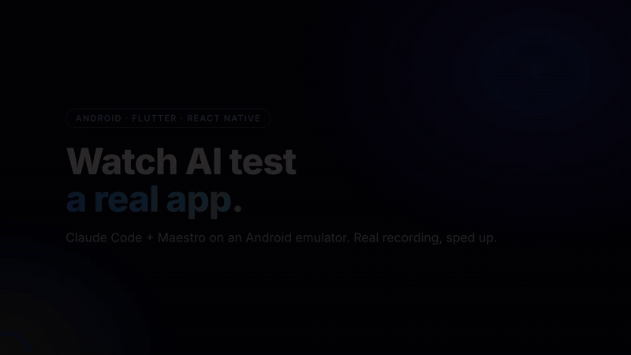

# maestro-claude-qa-kit

**Turn Claude Code into an autonomous tester for your Android app.**
It builds the app, installs it on an emulator, drives the real screens with
[Maestro](https://maestro.dev), looks at the screenshots and writes a bug report you can
paste into any AI coding session for the fix. No one has to sit at the emulator.

Built for apps written fast — Flutter, Expo / React Native, native Android — that
now hit the wall of "works on my phone, rejected by the store, crashes for users".



*A real run on a Flutter health app (LDPlayer, Windows), sped up 5–15×: the agent drives
the screens, finds a wrong "Not connected" status after one Health Connect permission
out of sixteen is denied, then re-checks every UI language and a small screen.*

> **Not an MCP server.** This kit is a set of files you copy into your app repo. It *uses*
> the official [Maestro MCP server](https://docs.maestro.dev/getting-started/maestro-mcp)
> (`maestro mcp`), which `.mcp.json` registers for Claude Code. Nothing here runs as a server.

## What is in the box

```
CLAUDE.md                     the tester role: what it may touch, the check cycle, report format, flow rules
.mcp.json                     registers the Maestro MCP server for Claude Code
.maestro/
  kit.env.example             app id, framework (flutter | expo | gradle | apk), paths
  .env.example                test account credentials (never committed)
  scripts/                    paired .ps1 (Windows) and .sh (macOS / Linux):
    init                        one-time setup, writes your app id into the flows
    build-install               build for the emulator's ABI and install; handles signature conflicts
    run                         runs flows with credentials, per-run artifacts, blank-screenshot detection,
                                stale-process cleanup, Windows-safe flow names
    cleanup                     keeps the disk from filling up (old runs, temp APKs, Maestro debug copies)
  subflows/                   launch (with retry), settle (paint wait), login, login_if_needed, login_fresh,
                              logout, dismiss_system_dialog — each with the "why" in comments
  smoke/                      two smoke flows to adapt: app launches, every tab opens
  cases/                      your per-change cases go here
docs/
  SELECTORS.md                test ids per framework (Flutter Semantics, RN testID, Compose testTag)
  REPORT_TEMPLATE.md          the report format
  TROUBLESHOOTING.md          every failure mode hit so far, with the fix
  INTAKE.md                   what to prepare before a setup
  CASE_TEMPLATE.yaml          skeleton for a new case
examples/flutter/test_id.dart a Flutter widget that makes Semantics identifiers reliable
```

## How this differs from "Maestro skills" for Claude Code

Several good skills teach the agent **how to write Maestro YAML**
([tovimx/maestro-mobile-testing-skill](https://github.com/tovimx/maestro-mobile-testing-skill),
[foreztgump/maestro-mobile-testing-skill](https://github.com/foreztgump/maestro-mobile-testing-skill)).
This kit is about the **process around the YAML**:

- a role that keeps the agent out of your app code and makes it report instead of "fix",
- scripts that make unattended runs survive real emulators (process kills, blank frames,
  signature conflicts, hung `adb`, disk filling up), on Windows as well as macOS,
- a report format that another AI session can act on,
- an explicit list of what is **not** tested automatically, so the report is honest.

Use them together: a skill for syntax, this kit for the workflow.

## Quickstart (10 minutes, Android)

Prerequisites: [Maestro CLI](https://docs.maestro.dev/getting-started/installing-maestro)
(Java 17+), Android SDK with `adb`, one running emulator, Claude Code.

1. Copy `CLAUDE.md`, `.mcp.json` and `.maestro/` into the root of your app repo
   (merge `CLAUDE.md` if you already have one).
   **Windows:** `maestro` is a `.bat` there and Claude Code cannot start it directly, so
   change `.mcp.json` to `"command": "cmd", "args": ["/c", "maestro", "mcp"]`.
2. Initialize:
   ```
   # Windows
   powershell -NoProfile -ExecutionPolicy Bypass -File .maestro\scripts\init.ps1 -AppId com.your.app -Framework flutter
   # macOS / Linux
   .maestro/scripts/init.sh --app-id com.your.app --framework expo
   ```
3. Fill in `.maestro/.env` with a **test account on a dev/staging backend**.
4. Add the ids from [docs/SELECTORS.md](docs/SELECTORS.md) to your login screen, main
   shell and tabs (`screen_login`, `screen_main`, `auth_login_*`, `nav_*`).
5. Build, install, smoke:
   ```
   .maestro\scripts\build-install.ps1        # or .sh
   .maestro\scripts\run.ps1 -Path .maestro\smoke
   ```
6. Fill in "Project facts" at the bottom of `CLAUDE.md`, start `claude` from the repo
   root and say: *"Check the last commit."*

From here the loop is: make a change → tell the tester what changed → get the report →
paste it into your coding session.

## Supported

- Android emulators: Android Studio AVD, LDPlayer, Genymotion; USB devices.
- Windows (PowerShell 5.1+), macOS, Linux.
- Flutter, native Android (Gradle), or any prebuilt APK.
- Expo / React Native: supported by the scripts (`build-install` makes a release variant
  so runs need no Metro), but **not yet tested on a real Expo project**. If you try it,
  an issue with what happened is very welcome.
- iOS: the same Maestro flows run on the iOS Simulator on a Mac; the scripts here are
  Android-only for now.

## Not automated (and said so in every report)

Google / Apple sign-in, in-app purchases, real push notifications, camera, wearables
with real data. The tester lists them under "Not covered automatically".

## Want it set up for you?

I set this up in your repo, add the ids, write the first cases for your screens and run
the first report. Fixed packages from $150, delivery from 3 days.
[Order on Fiverr](https://www.fiverr.com/cmyker32/test-your-android-app-automatically-with-claude-code-and-maestro) ·
[@OlegGregys on X](https://x.com/OlegGregys)

If the kit saved you an afternoon, a ⭐ helps other people find it.

## License

MIT. Use it, fork it, ship it.
